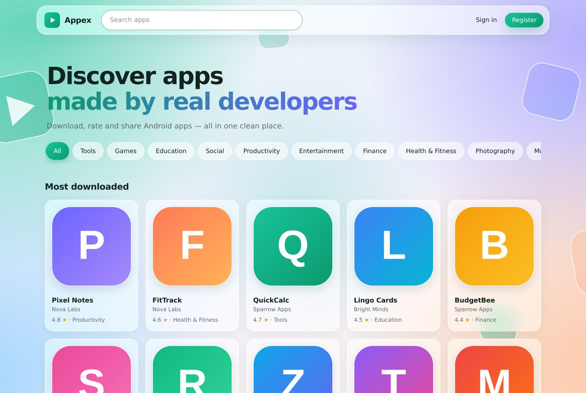
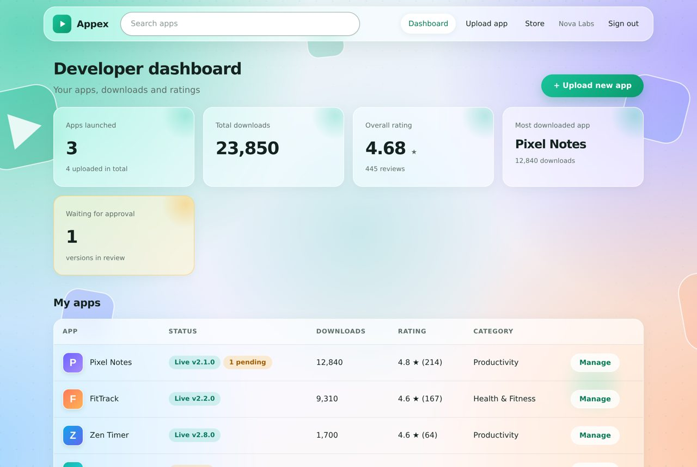
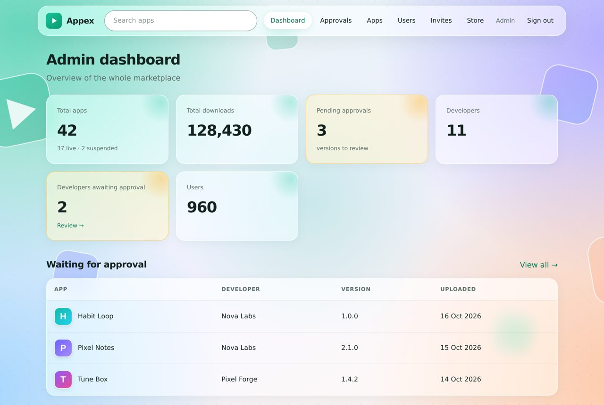
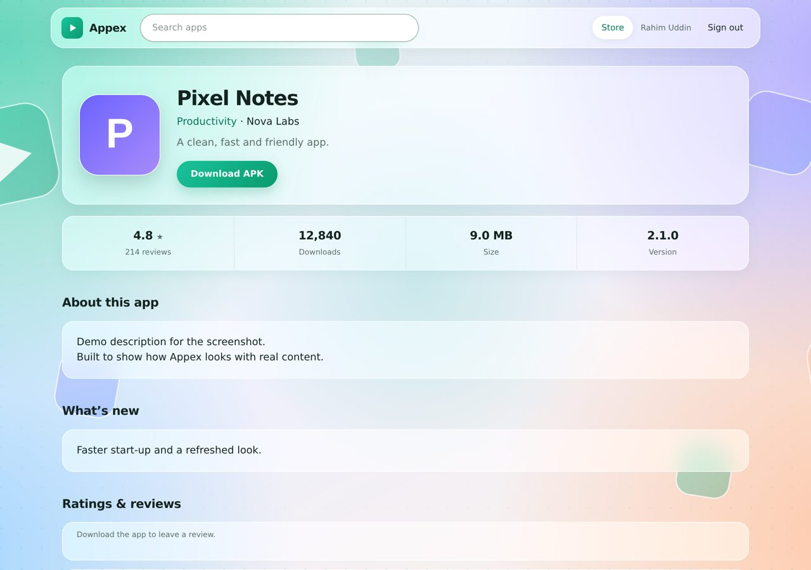
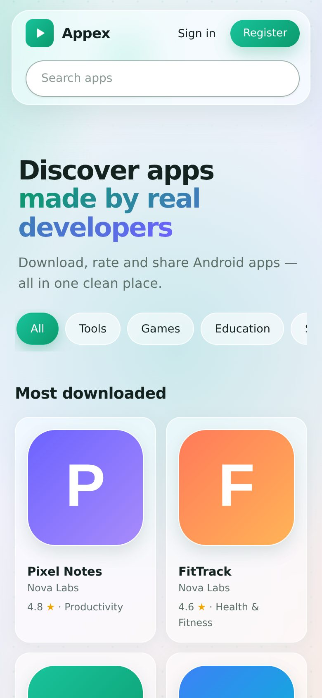

<div align="center">


# Appex

**Discover and publish Android apps.**
A Play Store-style APK marketplace with a clean glassmorphism UI.


[বাংলা সেটআপ গাইড](README.bn.md)

</div>

<p align="center">
  
</p>

## What is Appex?

Appex is a small, self-hosted app marketplace where **developers upload APKs**, **admins review every release**, and **users download and rate apps**. It runs entirely on a static frontend plus Supabase (Postgres, Auth, Storage) — no custom server to maintain.

## Features

**For users**
- Play Store-style store: search, categories, *Most downloaded*, *New & updated*
- App pages with version, size, changelog, ratings and reviews
- Reviews are only possible **after downloading** the app

**For developers** *(invite-only)*
- Join through an admin-created invite link
- Upload apps and new versions; **"What's new" is required** for every release
- Dashboard: apps launched, total downloads, overall rating, most downloaded app

**For admins**
- Approval queue: download the APK, test it, approve or reject with a reason
- Manage apps (suspend/restore) and users (ban/unban, approve/revoke developers)
- Create reusable developer invite links (optional expiry and sign-up limit, disable anytime)
- Dashboard: total apps, total downloads, pending approvals, developers, users
- Optional e-mail alerts: admins on every upload, developers on approve/reject

**Under the hood**
- Postgres **Row Level Security** and column-level grants: nobody can promote themselves, skip approval or fake downloads
- **Private APK storage** — files are only served through short-lived signed URLs, and each download is counted by a database function
- E-mail + password sign-in with a one-time e-mail verification code and a code-based password reset
- Responsive glassmorphism design, mobile first

## Screenshots

*(Demo data)*

| Developer dashboard | Admin dashboard |
|---|---|
|  |  |

| App page | Mobile |
|---|---|
|  |  |

## How it works

```
Developer uploads APK ─▶ version is "pending" ─▶ Admin tests & approves ─▶ app goes live
                                   │                        │
                          e-mail to admins          e-mail to developer
User signs in ─▶ downloads (counted once per user & version) ─▶ can rate & review
```

## Tech stack

| Layer | Technology |
|---|---|
| Frontend | HTML, CSS, vanilla JavaScript (no build step) |
| Database & API | Supabase Postgres + PostgREST, RPC functions |
| Auth | Supabase Auth (e-mail + password, e-mail OTP verification) |
| Files | Supabase Storage (private `apks`, public `icons`) |
| Notifications | Postgres triggers + `pg_net` + Brevo API *(optional)* |
| Hosting | Vercel (static) |

## Quick start

1. Create a project at [supabase.com](https://supabase.com).
2. In **SQL Editor** run, in order: `sql/01_schema.sql`, `02_functions.sql`, `03_rls.sql`, `04_storage.sql`, `05_seed.sql`, then `10_email_notifications.sql` and `11_require_changelog.sql`.
   *(Upgrading an older install? Run the numbered migrations `06` → `09` as well — see the [setup guide](README.bn.md).)*
3. Copy your **Project URL** and **publishable key** into `js/config.js`.
4. Configure custom SMTP in Supabase (Authentication → Emails) so verification codes can be delivered, and make the *Confirm signup* / *Reset password* templates show `{{ .Token }}`.
5. Open the folder with a local server (VS Code *Live Server*) or deploy to Vercel (*Framework preset: Other*).
6. Make yourself admin:
   ```sql
   insert into public.admin_emails (email) values ('you@example.com');
   ```
   then register with that e-mail and verify the code.

**Your own logo:** put it at `assets/logo.png` (lowercase) — it appears in the navbar and as the favicon.

## Project structure

```
appex/
├── index.html · app.html · login.html · register.html     store, app page, auth
├── developer/   dashboard · upload · app (versions)
├── admin/       dashboard · approvals · apps · users · invites
├── js/          config.js (your keys) · core.js (client, auth guard, helpers)
├── css/style.css
├── assets/logo.png · img/bg.svg
├── sql/         schema, functions, RLS, storage, migrations, e-mail notifications
└── docs/        screenshots · ABOUT.md (descriptions & captions)
```

## Security notes

- The Supabase **publishable key** in `js/config.js` is meant to be public — Row Level Security protects the data.
- **Never commit** the `secret`/`service_role` key, database password, SMTP app password or Brevo API key.
- Developer invite links grant the developer role to whoever uses them — share them only with people you trust and disable a link if it leaks.

## Limitations

- Supabase **Free plan** caps a single upload at **50 MB** and pauses idle projects after a week.
- Package name and version are entered by the developer (the APK is not parsed).
- There is no automatic malware scan; the admin's manual review is the safety net.

## Author

Built by **Masfiq Rahman Misha**.

## License

[MIT](LICENSE)
